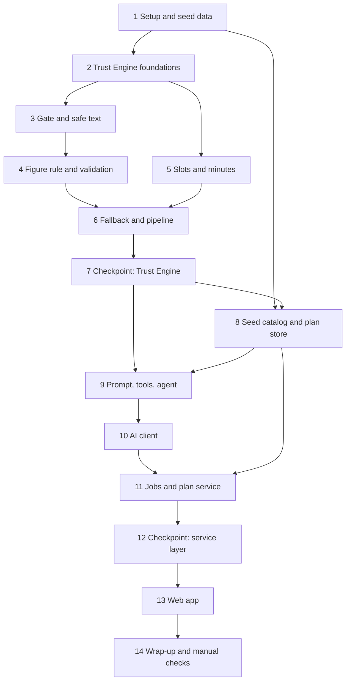

# Implementation Plan: weekly-plan

## Overview

Source: `requirements.md` (Requirements 1–12, D1–D6, "Agent design") and `design.md`. Work through the tasks in order. Each task builds on the ones before it, and nothing is left unwired.

Conventions for every task (also see Notes at the end):
- Run commands with `uv run` (the system `python3` is 3.9, the project needs 3.12).
- One automated test per [Auto] acceptance criterion, in `tests/`, named `test_req_<n>_<m>_<behaviour>`. Tests never call AWS (12.5). The save hook runs `uv run pytest`, so keep tests fast.
- The Trust Engine (`trust_engine/`) does no I/O and imports nothing from `planner/`, `web/`, `tools/` or `agent.py`.
- All Thai UI text lives in `web/strings_th.py`. Do not edit `structure.md`; list the new folders in `docs/handoff.md` for the team (design "Items to confirm" item 6).
- The design's "Items to confirm" are not answered yet. Tasks follow the design as written and mark where a decision matters.
- Do one task per session and note the result in `docs/handoff.md` when you stop.

If time runs short in the 3-hour build, cut in this order (last first): 14.2, 13.6 beyond the core routes, 10.2 real-client unit tests, 13.1 styling polish. Keep tasks 1–11 and 13.2–13.5 so the demo runs end to end.

## Task Dependency Graph



```json
{
  "waves": [
    { "wave": 1, "tasks": ["1.1", "1.2", "1.3"] },
    { "wave": 2, "tasks": ["2.1", "2.2", "2.3"] },
    { "wave": 3, "tasks": ["3.1", "5.1"] },
    { "wave": 4, "tasks": ["3.2"] },
    { "wave": 5, "tasks": ["3.3", "4.1"] },
    { "wave": 6, "tasks": ["4.2"] },
    { "wave": 7, "tasks": ["6.1"] },
    { "wave": 8, "tasks": ["6.2"] },
    { "wave": 9, "tasks": ["7"] },
    { "wave": 10, "tasks": ["8.1", "8.2", "9.1"] },
    { "wave": 11, "tasks": ["9.2"] },
    { "wave": 12, "tasks": ["9.3", "10.1", "11.1"] },
    { "wave": 13, "tasks": ["10.2"] },
    { "wave": 14, "tasks": ["11.2"] },
    { "wave": 15, "tasks": ["12"] },
    { "wave": 16, "tasks": ["13.1", "13.2"] },
    { "wave": 17, "tasks": ["13.3"] },
    { "wave": 18, "tasks": ["13.4"] },
    { "wave": 19, "tasks": ["13.5"] },
    { "wave": 20, "tasks": ["13.6", "14.1"] },
    { "wave": 21, "tasks": ["14.2", "14.3"] },
    { "wave": 22, "tasks": ["14.4"] }
  ]
}
```

Parallel work is possible after checkpoint 7: task 8 (seed and store) and task 9 (prompt, tools, agent) touch different folders. Inside task 13, 13.1 and 13.2 can run together, and 13.3 to 13.5 need both.

## Tasks

- [ ] 1. Project setup and seed data
  - [ ] 1.1 Add dependencies, folders and ignore rule
    - Run `uv add fastapi uvicorn jinja2` and `uv add --dev httpx`.
    - Add `var/` to `.gitignore`.
    - Create `trust_engine/`, `planner/`, `web/` (with `templates/` and `static/`), `prompts/`, `data/` with `__init__.py` where needed.
    - _Requirements: 2.1, 9.1_
  - [ ] 1.2 Move the three fictional shops to seed files
    - Create `data/seed_shop_001.json`, `seed_shop_002.json`, `seed_shop_003.json` from the dicts in `agent.py`. Fields: `shop_id`, `shop_name`, `type`, `menu_items`, `channels_used`, `owned_channels`, optional `closed_days` (Mon=0).
    - Keep `agent.py` importable and `tests/test_agent.py` passing.
    - _Requirements: 1.2, 1.4_
  - [ ] 1.3 Settings and model/Region check
    - Create `planner/settings.py` with `AI_PATH_LIMIT_S`, `MIN_RETRY_BUDGET_S`, `CONNECT_TIMEOUT_S`, `LOOPBACK_HOST`, `REQUIRED_MODEL_ID`, `REQUIRED_REGION`, `HEARTBEAT_GRACE_S`, `TZ` (UTC+7), and a `Settings` dataclass that reads `BELKA_MODEL_ID` and `BELKA_AWS_REGION`.
    - Add `check_model_config(settings)` that refuses `global.` and `apac.` prefixes, any other model ID, and any other Region.
    - Tests: accepted values pass; `global.…`, `apac.…`, a different model and a different Region are refused.
    - _Requirements: 12.1, 12.2_

- [ ] 2. Trust Engine foundations
  - [ ] 2.1 Data models
    - Create `trust_engine/models.py` with `MenuItem`, `ShopProfile`, `AiTaskDraft` (extra fields ignored), `AiPlanDraft` (no length or enum limits), `Task`, `Plan` as in the design.
    - Tests: an AI draft carrying `slot` and `minutes` fields parses and drops them; a `Plan` round-trips through JSON.
    - _Requirements: 3.2, 3.3, 9.2_
  - [ ] 2.2 Channels and content types
    - Create `trust_engine/channels.py`: channel list (LINE, Facebook, Instagram, TikTok, Google Maps) with caption limits, `MINUTES_BY_CHANNEL` (each value at most 10), `PREFERRED_TIME_BY_CHANNEL`, and a helper that marks owned channels for a profile.
    - Create `trust_engine/content_types.py` from the stub `CONTENT_TYPES` in `agent.py`.
    - Tests: every minutes value is at most 10; channel lookup is case-insensitive and returns the canonical name.
    - _Requirements: 3.4, 3.7_
  - [ ] 2.3 Text helpers
    - Create `trust_engine/text.py`: `normalise(text)` (NFKC, remove zero-width characters, case-fold, remove whitespace) returning the compact text and an index map to the original, and `thai_ratio(text, ignore)`.
    - Tests: spacing and zero-width characters inside a Thai term still map back to the right original span; the ratio ignores emoji, digits, URLs and given names.
    - _Requirements: 5.11, 3.10_

- [ ] 3. Message gate and safe text
  - [ ] 3.1 Red-line data
    - Create `trust_engine/redlines.py` with the categories from 5.10 (absolute claims, guarantees, health claims, urgency or scarcity, platform claims, unsourced statistics), literal terms and a few regular expressions, a replacement table with an entry or `None` per term, the Thai number and discount word list, and the weekday and day words from the figure rule.
    - Keep "ลดการพึ่งพา" allowed. Mark the lists as a starter set for review (5.12).
    - _Requirements: 5.10, 5.12, 10.2_
  - [ ] 3.2 Gate
    - Create `trust_engine/gate.py`: `gate(text) -> GateResult` with `Flag(category, term, start, end)` spans in the original text, and a `replace_flagged(text, flags)` helper that uses the replacement table.
    - Tests, one per category, plus: clean text unchanged; spacing and zero-width bypass attempts are still flagged; a flagged name from the profile is not exempt; "ลดการพึ่งพา" passes; the module imports no `boto3` or `strands`.
    - _Requirements: 5.2, 5.9, 5.10, 5.11_
  - [ ] 3.3 Safe text
    - Create `trust_engine/safe_text.py`: `safe_what`, `safe_reason`, `safe_caption(channel, profile, item_index)` with Thai templates per channel that use the shop name and one menu item and contain no figures.
    - Tests: every template, for every channel and every seed shop, passes the gate and the figure rule (added in 4.1; add that assertion there).
    - _Requirements: 5.4, 5.5, 5.6_

- [ ] 4. Figure rule and validation
  - [ ] 4.1 Figure rule
    - Create `trust_engine/figures.py`: remove the shop and menu names, then flag Arabic and Thai digits, number and discount words, weekday names and day words. A numeral is allowed only if it equals a menu price in the profile (Arabic or Thai digits).
    - Tests: invented discount rejected; a menu price allowed; a number inside a menu name allowed; a stated posting day or time rejected; Thai digits and spelled-out numbers rejected; no profit, GP or budget figure passes. Add the safe-text assertion from 3.3.
    - _Requirements: 10.1, 10.2, 10.3, 10.4_
  - [ ] 4.2 AI draft validation
    - Create `trust_engine/validation.py`: `validate_ai_draft(draft, profile) -> list[str]` of problem codes, checking in order: exactly 3 tasks; non-empty fields; supported channel; owned-channel rule (skipped when the profile lists none); shop or menu name in caption or reason; no duplicate channel and `what`; Thai ratio of at least 0.5 for caption and reason; no placeholders; caption length within the channel limit; figure rule. A partial plan is not repaired.
    - Tests: one per rule, including 2 valid tasks out of 3 (whole response invalid), 4 tasks (invalid), an empty reason (4.4), and no owned channel in the profile (rule waived).
    - _Requirements: 3.4, 3.5, 3.8, 3.9, 3.10, 4.3, 4.4_

- [ ] 5. Slots and minutes
  - [ ] 5.1 Slot assignment
    - Create `trust_engine/slots.py`: `assign_slots(channels, profile, now) -> list[Slot]` over the 7 days from the request date in Asia/Bangkok. Drop closed days and past times, spread tasks on positions `0`, `n//2`, `n-1`, take minutes from `MINUTES_BY_CHANNEL`, and check at most 10 minutes per day. Raise `SlotError` when fewer than 3 eligible days exist.
    - Tests: different days; no slot in the past; closed days avoided; daily total at most 10; same input gives the same output; a request late in the evening still gets 3 slots.
    - _Requirements: 3.6, 3.7, 7.9_

- [ ] 6. Fallback plan and finalize pipeline
  - [ ] 6.1 Fallback drafts
    - Create `trust_engine/fallback.py`: `build_fallback_drafts(profile, now)` picks 3 distinct channels (an owned one first when the profile has one, then used channels, then the rest), rotates the menu item by `now.date().toordinal() % len(items)`, and builds the texts from `safe_*`. No network and no AI.
    - Tests: 3 tasks with all fields; passes `validate_ai_draft`; works for a minimal profile (3 items, no channels, no closed days); same profile and date give the same plan; two shops give different text.
    - _Requirements: 7.5, 7.6, 7.7, 7.9_
  - [ ] 6.2 Finalize pipeline
    - Create `trust_engine/pipeline.py`: `finalize_plan(drafts, profile, now, source) -> Plan`. Assign slots and minutes, gate `what`, `reason` and `caption` for each task inside `try/except`, and apply the cases from the design: unchanged, corrected (re-gated), standard text, `gate_error` with no text. This is the only place that creates a `Plan`.
    - Tests: clean plan unchanged; flagged caption with replacements is corrected and shows the flagged terms; flagged with no replacement gets the standard caption and notice; flagged reason or `what` gets the standard text; gate raising an error gives `gate_error`; all 3 captions flagged still gives 3 tasks; AI-supplied slot or minutes are ignored.
    - _Requirements: 3.2, 3.3, 5.1, 5.3, 5.4, 5.5, 5.7, 5.8_

- [ ] 7. Checkpoint: Trust Engine
  - Run `uv run pytest`. All tests pass, none call AWS, and `trust_engine/` imports nothing outside itself. Ask the user if questions come up.

- [ ] 8. Seed catalog and plan store
  - [ ] 8.1 Seed catalog
    - Create `planner/seed.py`: `SeedCatalog.load(dir)` reads `data/seed_*.json`, builds `ShopProfile`s, and records Thai error messages that name the file and the field for unreadable files or missing fields (`shop_name`, `type`, at least 3 menu items, channel lists). `shop_id` must match `^[a-z0-9-]+$`.
    - Reject a profile with fewer than 3 open days (design "Items to confirm" item 4; change this if the team decides otherwise).
    - Tests: valid files load; a missing file field, a broken JSON file and fewer than 3 open days are reported with the file name and never produce a plan.
    - _Requirements: 1.1, 1.2, 1.3_
  - [ ] 8.2 Plan store
    - Create `planner/store.py`: `load` returning `(plan, corrupt)`, `save`, and `set_status` that changes a task only from `pending` and only when `plan_id` matches. Write to a temp file in the same folder, `fsync`, then `os.replace`. Use a per-shop lock. Files go to `var/plans/<shop_id>.json` with `schema_version: 1`.
    - Tests: save and load round trip; the saved file has the fields from 9.2 and no secrets; a new plan replaces the old one; a simulated write failure leaves the old file intact (9.7) and the task `pending` (9.5); a corrupt or unknown-version file loads as no plan with `corrupt=True` (9.6); a repeated or stale `set_status` changes nothing (6.8); no expiry (9.8).
    - _Requirements: 6.8, 9.1, 9.2, 9.4, 9.5, 9.6, 9.7, 9.8_

- [ ] 9. Prompt, tools and agent
  - [ ] 9.1 Prompt file
    - Create `prompts/weekly_plan.md` with the system prompt paragraph from "Agent design" in `requirements.md`, word for word.
    - _Requirements: 11.1_
  - [ ] 9.2 Tools
    - Create `tools/shop_tools.py` with `get_shop_profile`, `list_channels`, `list_content_types` as thin `@tool` wrappers over `SeedCatalog` and `trust_engine.channels` / `content_types`. Each result carries a `notice` that its text is data, not instructions. Unknown ids return `{"error": ...}`. Keep the docstrings clear.
    - Tests: the three tools return the shapes from "Agent design"; menu prices appear in the profile result; the tools make no network call.
    - _Requirements: 11.1, 11.3_
  - [ ] 9.3 Agent factory
    - Refactor `agent.py`: `build_agent(settings, system_prompt)` creates `BedrockModel` with `boto_client_config=Config(connect_timeout=2, read_timeout=8, retries={"max_attempts": 1})`, `ModelRetryStrategy(max_attempts=1)` (Strands retries throttling 6 times by default) and the three tools. Read the prompt from `prompts/weekly_plan.md`. Keep a module-level `agent` and the CLI loop so `tests/test_agent.py` and `uv run agent.py` still work.
    - Tests: the tool list is exactly the three read-only tools and contains no posting tool (6.6); the retry strategy allows one attempt; importing `agent` makes no AWS call; model ID and Region come from settings.
    - _Requirements: 6.6, 11.3, 12.1, 12.3, 12.5_

- [ ] 10. AI client
  - [ ] 10.1 Client interface and stub
    - Create `planner/ai_client.py` with `AiError(cause)`, the `AiPlanClient` protocol (`draft(shop_id, retry_note, cancel) -> AiPlanDraft`) and `StubAiPlanClient`. The stub takes a script (`ok(draft)`, `malformed`, `sleep(seconds)`, `raise(cause)`), counts calls, and can simulate success, malformed output, timeout, unreachable, access denied, expired sign-in and throttling.
    - Tests: the stub plays each behaviour and counts calls.
    - _Requirements: 12.5_
  - [ ] 10.2 Strands client and error mapping
    - Add `StrandsAiPlanClient`: builds a new agent per attempt, calls `agent(message, structured_output_model=AiPlanDraft, cancel_signal=event)`, and maps exceptions to the causes in the design (`invalid_format`, `timeout`, `access_denied`, `sso_expired`, `throttled`, `unreachable`, `other`). The retry note is a fixed English text listing problem codes.
    - Tests with fabricated exceptions (no AWS): each exception maps to the expected cause; a structured-output failure maps to `invalid_format`.
    - _Requirements: 7.2, 7.3, 12.3_

- [ ] 11. Jobs and plan service
  - [ ] 11.1 Job registry
    - Create `planner/jobs.py`: `Job` (state, cancel event, `last_seen`, lock) and `JobRegistry` with `start` (one running job per shop; returns the running job if one exists), `get`, `cancel` (no-op when done; releases the shop guard at once) and `finish_ok` (under the job lock: discard if cancelled, else save and set `done`).
    - Tests: two rapid starts for one shop give one job; cancel then a new start is allowed at once; a late result from a cancelled job is never saved; cancel after `done` leaves the saved plan.
    - _Requirements: 8.4, 8.5, 8.7, 8.8_
  - [ ] 11.2 Plan service
    - Create `planner/service.py`: `PlanService.request_plan` starts a job and runs `_run` in a worker thread. `_run` checks the model config (12.2), then loops up to 2 attempts: submit `client.draft` to a one-thread executor and poll every 100 ms until it finishes, the 8 s deadline passes, the owner cancels, or the progress page has been silent for `HEARTBEAT_GRACE_S`. Validate the draft. Retry once only for `timeout` or `invalid_format` and only if at least `MIN_RETRY_BUDGET_S` remain. Otherwise log the cause and use the fallback. Finalize with `finalize_plan` and save through `finish_ok`.
    - Add the `key=value` log line (`event`, `cause`, `shop`, `job`, `attempt`, `hint`; the `sso_expired` line says to run `aws sso login`; no captions or secrets). A cancel logs `event=cancelled` and is not a failure.
    - Add `set_status(shop_id, plan_id, task_id, status)` delegating to the store.
    - Tests with `StubAiPlanClient` and a 0.3 s limit: success path; malformed then valid (retry); malformed twice (fallback, at most 2 attempts); timeout; access denied, sign-in expired, throttled, unreachable and other (fallback with no retry); wrong model config (no client call, `config_refused`); fallback appears within 1 s after the limit; cancel at each step saves nothing, keeps the old plan and shows no fallback; late result after cancel is ignored; page silence acts as cancel; log lines carry the cause and no secrets; a gate flag is not logged as a failure.
    - _Requirements: 7.1, 7.2, 7.3, 7.4, 7.10, 7.11, 7.12, 7.13, 8.5, 8.6, 8.7, 8.9, 8.10, 12.2_

- [ ] 12. Checkpoint: service layer
  - Run `uv run pytest`. All tests pass with no AWS call. Ask the user if questions come up.

- [ ] 13. Web app
  - [ ] 13.1 Thai strings, base template and phone layout
    - Create `web/strings_th.py` with every Thai UI string (button labels from the spec are proposals), `web/templates/base.html`, and `web/static/app.css` for a single column sized for 360–430 px, touch targets of at least 44×44 px, no horizontal scroll at 360 px.
    - _Requirements: 2.3, 2.4, 2.5_
  - [ ] 13.2 App shell and loopback security
    - Create `web/main.py` (`create_app(settings, client)`), `web/security.py` (middleware that rejects a non-loopback `Host` and any `POST` with a non-loopback `Origin` before any handler), and `web/__main__.py` (Uvicorn on `LOOPBACK_HOST`, one worker). Add a global exception handler that returns a Thai error page with no stack trace.
    - Tests: the run function binds `127.0.0.1` and one worker; a bad `Host` or `Origin` is rejected and changes no state; an unhandled error returns the Thai error page.
    - _Requirements: 2.1, 2.2, 2.12, 7.12_
  - [ ] 13.3 Request, progress and cancel screens
    - Add `GET /` (request screen with shop name, shop selector when more than one valid shop, seed error banners), `POST /shops/{id}/plan` (start or return the running job, `303` to the progress page), `GET /jobs/{job_id}` (progress screen with "ยกเลิก"), `GET /api/jobs/{job_id}` (JSON state, updates `last_seen`), `POST /jobs/{job_id}/cancel`.
    - Add `web/static/app.js`: poll every second and redirect on `done` or `cancelled`; disable the request button after the first tap; `sendBeacon` cancel on `pagehide` unless the job finished.
    - Tests: request screen content; double-tap starts one job and one stub attempt; progress screen shows status and cancel; cancel returns to the previous plan.
    - _Requirements: 2.6, 2.7, 8.1, 8.2, 8.4, 8.5_
  - [ ] 13.4 Plan screen
    - Add `GET /shops/{id}/plan` and the plan template: date range (request date to +6 days), "ขอแผนใหม่", fallback banner, and per task a card with what, channel, slot, minutes, caption, a `<details>` element holding the reason ("ทำไมต้องทำ?"), the corrected or standard-text notice, and the pending actions. A `gate_error` task shows "ตรวจข้อความไม่สำเร็จ" and only "ข้าม". Profile text is escaped.
    - Tests: 3 tasks with all fields; a reason control on every task; fallback banner only for `source=fallback`; notices for corrected and standard text; no confirm button on a `gate_error` task; profile text with markup is escaped.
    - _Requirements: 2.8, 2.9, 2.10, 3.1, 3.11, 4.1, 4.2, 5.3, 5.4, 5.7, 6.1, 7.8, 9.3, 9.9, 11.4_
  - [ ] 13.5 Confirm, skip and summary
    - Add `POST /shops/{id}/tasks/{task_id}/confirm` (JSON `{plan_id, copy_ok}`) and `.../skip` (JSON `{plan_id}`), both going through `PlanService.set_status`. Confirm sets `ready` even when `copy_ok` is false and the page then shows the caption as selectable text with the Thai notice. Add the clipboard code to `app.js` (`navigator.clipboard.writeText`, fallback `execCommand('copy')`) and the "คัดลอกอีกครั้ง" button for ready tasks. The confirm text says the caption is ready for the owner to post, never "posted". Add the summary screen (each task with its status, "ขอแผนใหม่", acknowledgement when all 3 are skipped).
    - Tests: confirm sets `ready` and saves; skip sets `skipped`; a repeated or stale request changes nothing; a save failure shows the Thai error and the task stays `pending`; no route calls an external service and no page says "posted"; summary appears when all tasks are decided; all-skipped shows the acknowledgement and no error.
    - _Requirements: 2.11, 6.2, 6.4, 6.5, 6.7, 6.8, 6.10, 6.11, 9.5_
  - [ ] 13.6 Prompt injection and end-to-end tests
    - Test: profile text is passed to the agent only as tool data with the notice, and the tool set stays fixed. A stub answer that "obeyed" an injected instruction (for example a caption with "ดีที่สุด" and a new discount figure) is caught by validation or the gate.
    - Test the full path through the web client with the stub: request, progress, plan, confirm, skip, summary, then a new request that replaces the plan; and a path where every attempt fails and the fallback plan is shown.
    - _Requirements: 3.1, 7.12, 11.2, 11.3_

- [ ] 14. Wrap-up and manual checks
  - [ ] 14.1 Run it for real
    - Run `aws sso login`, then `uv run python -m web` and open `http://127.0.0.1:8000`. Request a plan for each seed shop on real Bedrock and note the time taken. If it often exceeds 8 s, stop and raise design "Items to confirm" item 5 with the team before changing the agent design.
    - _Requirements: 12.6, 7.1_
  - [ ] 14.2 Manual checklist
    - Go through M1–M8 from `requirements.md` (layout and Thai UI, Thai quality review of AI and fallback plans, clipboard behaviour, real Bedrock and forced fallback, injected menu item, seed review, page reload during generation, code review of keys and the git-ignored plan file). Record pass or fail and the date in `docs/handoff.md`.
    - _Requirements: 1.4, 2.3, 2.4, 2.5, 4.6, 5.12, 6.3, 6.4, 6.9, 8.3, 8.9, 9.1, 11.5, 12.3, 12.4, 12.6_
  - [ ] 14.3 Handoff
    - Update `docs/handoff.md`: what was built, how to run it, the new folders (`planner/`, `web/`, `var/`) that `structure.md` does not list yet, and the unanswered "Items to confirm" from `design.md` and the open questions from `requirements.md`.
  - [ ] 14.4 Final checkpoint
    - Run `uv run pytest`. All tests pass, none call AWS, and the demo runs end to end. Ask the user if questions come up.

## Notes

- Every acceptance criterion tagged [Auto] in `requirements.md` has a test named in the task that implements it. Criteria tagged [Manual] are in task 14.2.
- Not yet decided by the team (see `design.md`, "Items to confirm"): gating `what` (done in 6.2), counting one attempt as one Bedrock call (11.2), minutes by channel only (2.2), the 3-open-day seed rule (8.1), the latency fix if 8 s is too tight (14.1), and updating `structure.md` for `planner/`, `web/`, `var/` (14.3).
- Tests use small time limits and real sleeps, not a fake clock, so timing tests stay under a few seconds.
- Do not add any posting code, tool or route at any point (6.5, 6.6).
- Do not commit `var/`, `.env` or any credentials.
